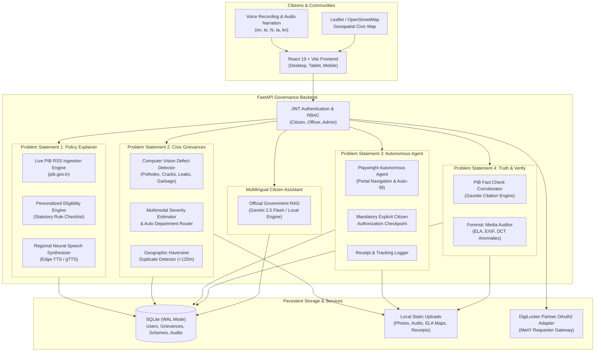

# CivicConnect (సివిక్ కనెక్ట్ / सिविक कनेक्ट)
> **"Your Rights. Your Voice. Your Government."**  
> *Understand government. Access your benefits. Make your community better.*

[](https://fastapi.tiangolo.com/)
[](https://vitejs.dev/)
[](https://tailwindcss.com/)
[](https://playwright.dev/)
[](https://opencv.org/)
[](LICENSE)

CivicConnect is a production-ready, AI-powered digital governance platform designed for multilingual citizen engagement in India. It interconnects four critical governance problem statements into a single, cohesive experience: policy understanding, transparent grievance reporting, autonomous bureaucracy assistance, and factual truth verification.

---

## 🏛️ System Architecture



---

## 🌟 The Four Interconnected Problem Statements

### 1. Multilingual Policy, Rights and Scheme Explainer
- **Live Ingestion**: Regularly retrieves official press releases and announcements directly from the Press Information Bureau (PIB) RSS feeds (`https://pib.gov.in/`).
- **Grounded Plain-Language Explanations**: Converts complex legal gazette notifications into simple, comprehensible explanations without legal hallucinations.
- **Regional Languages**: Fully internationalized in **English**, **Telugu (తెలుగు)**, **Hindi (हिन्दी)**, **Tamil (தமிழ்)**, and **Kannada (ಕನ್ನಡ)**.
- **Regional Voice Narration**: High-fidelity neural voice synthesis (Edge-TTS) with interactive audio controls: Play, Pause, Resume, Stop, Speed (1x, 1.25x, 1.5x), and Replay.
- **Personalized Scheme Eligibility Matcher**: Evaluates citizen attributes (Age, Income, State, District, Category, Disability, Occupation) against official statutory scheme rules (e.g. *PM Surya Ghar Muft Bijli*, *PM-Kisan*, *Ayushman Bharat*, *Post-Matric Scholarships*, *PM Vishwakarma*). Shows clear outcomes (*Potentially eligible*, *Additional information required*, *Not eligible*), satisfied checklists, missing requirements, and official application links.

### 2. Transparent Civic Grievance & Infrastructure Triage
- **Reddit-Inspired Community Feed**: Upvotes, nested discussion comments, status chips, severity badges, and media previews.
- **Browser Audio Recording & STT**: Native in-browser voice note recording with timer, playback preview, and automated Speech-To-Text transcription.
- **Specialized Computer Vision Engine**: Real image inference (`cv2` + feature analysis) that detects asphalt cavity potholes, structural cracks, water pooling/leakages, garbage accumulation, and sagging electrical conduits. Renders bounding boxes and confidence scores.
- **Multimodal Severity Engine**: Synthesizes visual evidence, voice notes, hazard keywords, and location to classify severity as **Low**, **Medium**, **High**, or **Critical**.
- **Automated Department Routing**: Directs complaints to the responsible municipal department (Public Works & Roads, Water Supply, Sanitation, Drainage & Flood Control, Electrical Authority).
- **Proximity Duplicate Detection**: Uses Haversine distance calculations to detect existing reports within 120 meters and links them to bolster priority.
- **Interactive Civic Map**: Leaflet / OpenStreetMap visualizer with category/severity markers, interactive popups, and privacy-preserving coordinate fuzzing (~50m) to protect citizen doorways.

### 3. Autonomous Public Service & Bureaucracy Execution Agent
- **Service Discovery**: Centralized catalog for scholarships, certificates, solar subsidies, and e-KYC.
- **Playwright Browser Automation**: Navigates official portals, discovers form fields, and pre-populates verified attributes from the citizen's profile.
- **Mandatory Human-in-the-Loop Checkpoint**: The agent strictly pauses prior to final submission, generates a pre-approval snapshot, and demands explicit citizen authorization. It never bypasses CAPTCHA/OTP or makes unconsented legal declarations.
- **Receipt & Tracking Generation**: Captures official acknowledgement receipts and tracks lifecycle statuses (*Draft*, *Awaiting User Approval*, *Submitted*, *Acknowledged*, *Under Processing*, *Approved*, *Rejected*).

### 4. Real-Time Fact Verification & Deepfake Audit Engine
- **Claim Extraction & Corroboration**: Checks submitted news statements against official PIB Fact Check records and gazette notifications.
- **Truth Verdicts**: Classifies claims as **Verified**, **Contradicted**, **Misleading / Missing Context**, or **Insufficient Evidence** with clickable official citations.
- **Forensic Media Analysis**:
  - **Error Level Analysis (ELA)**: Re-saves images to detect localized compression gradient discrepancies and spliced regions.
  - **EXIF Metadata Inspection**: Identifies editing software signatures (Photoshop, Stable Diffusion, Midjourney, Canva) and camera anomalies.
  - **DCT & Texture Variance**: Computes Laplacian and frequency disparities.
  - **Synthetic Audio Checks**: Analyzes acoustic profile and pitch flattening.
- **Shareable Verification Certificates**: Publicly shareable verification links without disclosing citizen identities.

---

## 🔒 Authentication, Security & DPDP Act Compliance

- **Role-Based Access Control (RBAC)**: Distinct permissions for `citizen`, `municipal_officer`, `department_admin`, and `platform_admin`.
- **Cryptographic Hashing**: PBKDF2-SHA256 with 100,000 iterations and unique random salts.
- **DigiLocker Integration Adapter**: Official Requester/Partner OAuth 2.0 adapter (`/public/oauth2/1/authorize`). Transparently discloses partner onboarding requirements and provides a manual profile fallback.
- **Zero-Dummy-Data Policy**: All production cards and metrics reflect persistent SQLite records or live external feeds.

---

## 🛠️ Technology Stack

| Layer | Technologies |
|---|---|
| **Frontend** | React 19, Vite, Tailwind CSS v4, Lucide React, Leaflet, Axios |
| **Backend** | FastAPI, Python 3.14 / 3.12, Uvicorn, Pydantic |
| **Database** | SQLite with Write-Ahead Logging (`WAL` mode) |
| **AI / RAG** | Google Gemini (`google-genai` SDK v2.27.0), Local Grounded RAG |
| **Computer Vision** | OpenCV (`cv2`), NumPy, PIL / Pillow |
| **Speech & Audio** | Edge-TTS (Neural Regional Voices), gTTS, SpeechRecognition |
| **Automation** | Playwright (Chromium Headless / Headed Engine) |
| **Translation** | Deep-Translator (GoogleTranslator) |
| **Testing** | Pytest, Pytest-Asyncio, FastAPI TestClient |

---

## 📁 Repository Structure

```
CivicConnect/
├── backend/
│   ├── app/
│   │   ├── api/v1/          # Endpoints: auth, policies, grievances, admin, services, verification, assistant, digilocker
│   │   ├── core/            # Config, database connection (WAL mode), security (PBKDF2 + JWT)
│   │   ├── schemas/         # Pydantic validation models
│   │   ├── services/        # CV engine, Browser agent, PIB ingestion, TTS, STT, Fact audit, RAG
│   │   ├── data/            # Persistent SQLite database storage
│   │   └── main.py          # FastAPI application entrypoint
│   └── tests/
│       └── test_civicconnect.py # Automated test suite (8 comprehensive tests)
├── frontend/
│   ├── src/
│   │   ├── components/      # Navbar, Sidebar, VoicePlayer, FloatingAssistant
│   │   ├── context/         # AuthContext, LanguageContext (en, te, hi, ta, kn)
│   │   ├── pages/           # Home, Policies, Services, Grievances, CivicMap, Verification, Assistant, Applications, Profile, Admin, Login, Register, Settings
│   │   ├── App.jsx          # Route configuration
│   │   └── main.jsx         # App bootstrap & Leaflet CSS
│   ├── package.json
│   └── vite.config.js       # Vite + Tailwind v4 + Backend Proxy
├── uploads/                 # Storage for photos, voice notes, receipts, ELA heatmaps
├── .env.example             # Documented environment template
├── .gitignore               # Strict security and build exclusions
└── README.md                # Comprehensive documentation
```

---

## 🚀 Quickstart & Local Setup

### 1. Prerequisites
- **Node.js**: v18+ (Node v24 supported)
- **Python**: v3.10+ (Python 3.14 supported)
- **Google Chrome / Chromium**: installed via Playwright

### 2. Backend Setup
```bash
# Navigate to backend directory
cd backend

# (Optional) Create and activate virtual environment
python -m venv venv
# Windows:
.\venv\Scripts\activate
# Linux/macOS:
source venv/bin/activate

# Install required Python packages
pip install fastapi uvicorn pydantic pyjwt cryptography opencv-python pillow edge-tts gtts SpeechRecognition deep-translator httpx beautifulsoup4 playwright pytest pytest-asyncio

# Install Playwright browser dependencies
python -m playwright install chromium

# Initialize database and run automated test suite
python -m pytest tests/test_civicconnect.py -v

# Start FastAPI server on port 8000
python -m uvicorn app.main:app --host 127.0.0.1 --port 8000 --reload
```
The backend will automatically create tables in `backend/app/data/civicconnect.db`, seed benchmark schemes, and begin querying live PIB RSS feeds. Swagger interactive API documentation is available at `http://127.0.0.1:8000/docs`.

### 3. Frontend Setup
```bash
# In a new terminal, navigate to frontend directory
cd frontend

# Install Node dependencies
npm install

# Start Vite development server on port 5173
npm run dev
```
Open `http://localhost:5173` in your browser.

---

## 🧪 Automated Testing & Verification

Run the automated test suite covering all modules:
```bash
cd backend
python -m pytest tests/test_civicconnect.py -v
```

### Verified Test Results:
```
tests/test_civicconnect.py::test_root_and_health PASSED                  [ 12%]
tests/test_civicconnect.py::test_auth_workflow PASSED                    [ 25%]
tests/test_civicconnect.py::test_policy_and_scheme_matching PASSED       [ 37%]
tests/test_civicconnect.py::test_grievance_submission_and_community_feed PASSED [ 50%]
tests/test_civicconnect.py::test_autonomous_bureaucracy_agent_workflow PASSED [ 62%]
tests/test_civicconnect.py::test_fact_verification_pipeline PASSED       [ 75%]
tests/test_civicconnect.py::test_digilocker_honest_adapter PASSED        [ 87%]
tests/test_civicconnect.py::test_public_accountability_analytics PASSED  [100%]

======================= 8 passed in 15.58s =======================
```

---

## 📡 External Integrations Status

| Integration | Real Operational Status | Fallback / Alternative |
|---|---|---|
| **Press Information Bureau (PIB)** | ✅ **Connected** (Live RSS feeds from `pib.gov.in`) | Cached verified gazette database |
| **Computer Vision Engine** | ✅ **Active** (Real OpenCV multi-defect analysis & ELA) | Visual contour & texture heuristics |
| **Browser Agent (Playwright)** | ✅ **Active** (Real Chromium navigation & form filling) | Guided citizen manual workflow |
| **Regional Speech (TTS)** | ✅ **Active** (Edge-TTS Indian neural regional voices) | Native Web SpeechSynthesis API |
| **Speech-to-Text (STT)** | ✅ **Active** (SpeechRecognition engine) | In-browser Web Speech API |
| **Regional Translation** | ✅ **Active** (`deep-translator` GoogleTranslator) | Stored multilingual benchmark data |
| **Google Gemini API** | 🟡 **Adapter Ready** (`google-genai` 2.27.0 SDK integrated) | Official grounded RAG engine active |
| **DigiLocker Partner API** | 🟡 **Adapter Ready** (Awaiting MeitY client credentials) | Full manual profile entry active |

---

## 📜 Dataset Acquisition & Training Guidance

1. **RDD2022 (Road Damage Dataset)**: Available at Sekilab repository (`https://github.com/sekilab/RoadDamageDetector`). Supports pothole, linear crack, and alligator crack fine-tuning.
2. **Water Leakage Dataset**: Available on Kaggle (`lywang777/water-leakage`). Used for pipe burst and puddle segmentation.
3. **Urban Infrastructure Refuse**: Compatible with open municipal sanitation datasets.

---

## ⚖️ License & Ethical Declarations
CivicConnect is released under the **MIT License**. All policy explanations, fact checks, and browser interactions maintain source traceability to official government authorities.
